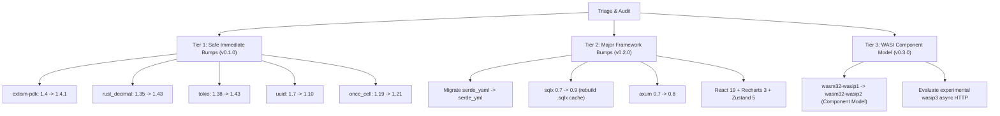

# NockNock Dependency Audit & Upgrade Roadmap

This document benchmarks all runtime targets, WASM toolchains, Rust crates, and npm dependencies across **NockNock** against the latest upstream releases, tracks known deprecations, and outlines our phased upgrade strategy.

---

## 1. WASI Target Evolution (`wasip1` ➔ `wasip2` ➔ `wasip3`)

| Target / Standard | Current Status in NockNock | Ecosystem Maturity | Verification & Reference Link |
| :--- | :---: | :--- | :--- |
| **`wasm32-wasip1`** | **Active Target** | **Stable & Universal**. Baseline POSIX-like preview supported by Extism PDK and all major host runtimes. | [Rust Platform Support: wasip1](https://doc.rust-lang.org/rustc/platform-support/wasm32-wasip1.html) |
| **`wasm32-wasip2`** | Available in local toolchain | **Stable Component Model (WASI 0.2)**. Native typed WIT components (`wit-bindgen`), streams, and resource types. | [Rust Platform Support: wasip2](https://doc.rust-lang.org/rustc/platform-support/wasm32-wasip2.html) |
| **`wasip3`** | Documented Roadmap | **Experimental (WASI 0.3 Draft)**. Native async component model (async HTTP, task cancellation). Currently exposed via the [`wasip3`](https://docs.rs/wasip3/latest/wasip3/) crate for bleeding-edge Wasmtime / Spin runtimes. | [docs.rs/wasip3](https://docs.rs/wasip3/latest/wasip3/) |

### Architectural Gap Analysis:
* Our WASM Brain currently relies on [`extism-pdk = "1.4"`](https://crates.io/crates/extism-pdk), which uses Extism's host memory-offset ABI rather than the WASI 0.2/0.3 Component Model runtime.
* Migrating to `wasm32-wasip2` or `wasip3` will require transitioning the host runtime from Extism to Wasmtime Component Model or Spin SDK. This is tracked for milestone **v0.3.0**.

---

## 2. WASM Brain Dependencies (`brain/Cargo.toml`)

| Crate | Current Spec | Latest Upstream | Classification | Upgrade Action / Notes | Reference Link |
| :--- | :---: | :---: | :---: | :--- | :--- |
| [`extism-pdk`](https://crates.io/crates/extism-pdk) | `1.4` | `1.4.1` | **Safe** | Bump to `1.4.1`. | [crates.io/crates/extism-pdk](https://crates.io/crates/extism-pdk) |
| [`rust_decimal`](https://crates.io/crates/rust_decimal) | `1.35` | `1.43.0` | **Safe** | Bump to `1.43` for math and serialization performance. | [crates.io/crates/rust_decimal](https://crates.io/crates/rust_decimal) |
| [`rust_decimal_macros`](https://crates.io/crates/rust_decimal_macros) | `1.35` | `1.43.0` | **Safe** | Bump to `1.43` matching `rust_decimal`. | [crates.io/crates/rust_decimal_macros](https://crates.io/crates/rust_decimal_macros) |
| [`serde`](https://crates.io/crates/serde) | `1.0` | `1.0.229` | **Safe** | Managed via Cargo lockfile. | [crates.io/crates/serde](https://crates.io/crates/serde) |
| [`serde_json`](https://crates.io/crates/serde_json) | `1.0` | `1.0.154` | **Safe** | Managed via Cargo lockfile. | [crates.io/crates/serde_json](https://crates.io/crates/serde_json) |
| [`chrono`](https://crates.io/crates/chrono) | `0.4` | `0.4.45` | **Safe** | Retain `0.4` with `serde` features. | [crates.io/crates/chrono](https://crates.io/crates/chrono) |
| [`ulid`](https://crates.io/crates/ulid) | `1.0` | `3.0.0` | **Breaking** | Hold at `1.0`. `v3.0` has breaking API changes in generator traits. | [crates.io/crates/ulid](https://crates.io/crates/ulid) |
| [`sha2`](https://crates.io/crates/sha2) | `0.10` | `0.11.0` | **Breaking** | Hold at `0.10`. `v0.11` modifies `Digest` trait bounds in RustCrypto. | [crates.io/crates/sha2](https://crates.io/crates/sha2) |
| [`schemars`](https://crates.io/crates/schemars) | `0.8` (opt) | `1.2.2` | **Breaking** | Optional feature; hold at `0.8`. | [crates.io/crates/schemars](https://crates.io/crates/schemars) |

---

## 3. Ingestion Worker & MCP Backend (`ingestion-worker/Cargo.toml`)

| Crate | Current Spec | Latest Upstream | Classification | Upgrade Action / Notes | Reference Link |
| :--- | :---: | :---: | :---: | :--- | :--- |
| [`tokio`](https://crates.io/crates/tokio) | `1.38` | `1.53.2` | **Safe** | Bump to `1.43` for scheduler performance. | [crates.io/crates/tokio](https://crates.io/crates/tokio) |
| [`uuid`](https://crates.io/crates/uuid) | `1.7` | `1.28.0` | **Safe** | Bump to `1.10` (features: `serde`, `v7`). | [crates.io/crates/uuid](https://crates.io/crates/uuid) |
| [`once_cell`](https://crates.io/crates/once_cell) | `1.19` | `1.21.4` | **Safe** | Bump to `1.21` (or migrate to `std::sync::OnceLock`). | [crates.io/crates/once_cell](https://crates.io/crates/once_cell) |
| [`serde_yaml`](https://crates.io/crates/serde_yaml) | `0.9` | `0.9.34+deprecated` | **Deprecated** | Deprecated upstream. Migrate to [`serde_yml`](https://crates.io/crates/serde_yml) in v0.2.0. | [crates.io/crates/serde_yaml](https://crates.io/crates/serde_yaml) |
| [`sqlx`](https://crates.io/crates/sqlx) | `0.7` | `0.9.0` | **Major** | Hold at `0.7` for v0.1.0 release. Upgrading to `0.9` requires regenerating `.sqlx/` query cache with a live DB. | [crates.io/crates/sqlx](https://crates.io/crates/sqlx) |
| [`axum`](https://crates.io/crates/axum) | `0.7` | `0.8.9` | **Major** | Hold at `0.7`. Axum 0.8 refactors route traits and extractor hierarchies. | [crates.io/crates/axum](https://crates.io/crates/axum) |
| [`tower-http`](https://crates.io/crates/tower-http) | `0.6` | `0.7.1` | **Aligned** | Aligned with Axum 0.7. | [crates.io/crates/tower-http](https://crates.io/crates/tower-http) |
| [`reqwest`](https://crates.io/crates/reqwest) | `0.12` | `0.13.5` | **Safe** | Retain `0.12` for HTTP Alchemy JSON-RPC. | [crates.io/crates/reqwest](https://crates.io/crates/reqwest) |
| [`tokio-cron-scheduler`](https://crates.io/crates/tokio-cron-scheduler) | `0.12` | `0.15.1` | **Safe** | Retain `0.12`. | [crates.io/crates/tokio-cron-scheduler](https://crates.io/crates/tokio-cron-scheduler) |
| [`tracing`](https://crates.io/crates/tracing) | `0.1` | `0.1.44` | **Safe** | Managed via Cargo lockfile. | [crates.io/crates/tracing](https://crates.io/crates/tracing) |
| [`tracing-subscriber`](https://crates.io/crates/tracing-subscriber) | `0.3` | `0.3.23` | **Safe** | Managed via Cargo lockfile. | [crates.io/crates/tracing-subscriber](https://crates.io/crates/tracing-subscriber) |
| [`anyhow`](https://crates.io/crates/anyhow) | `1.0` | `1.0.104` | **Safe** | Managed via Cargo lockfile. | [crates.io/crates/anyhow](https://crates.io/crates/anyhow) |
| [`hex`](https://crates.io/crates/hex) | `0.4` | `0.4.3` | **Safe** | Stable. | [crates.io/crates/hex](https://crates.io/crates/hex) |

---

## 4. Frontend Dashboard (`frontend/package.json`)

| Package | Installed Spec | Latest Upstream | Classification | Upgrade Action / Notes | Reference Link |
| :--- | :---: | :---: | :---: | :--- | :--- |
| [`react`](https://www.npmjs.com/package/react) | `18.3.1` | `19.3.0` | **Major** | Hold at `18.3` for v0.1.0 release. React 19 requires Recharts and Zustand ecosystem compatibility checks. | [npmjs.com/package/react](https://www.npmjs.com/package/react) |
| [`react-dom`](https://www.npmjs.com/package/react-dom) | `18.3.1` | `19.3.0` | **Major** | Aligned with React 18. | [npmjs.com/package/react-dom](https://www.npmjs.com/package/react-dom) |
| [`recharts`](https://www.npmjs.com/package/recharts) | `2.15.4` | `3.10.1` | **Major** | Hold at `2.15`. Recharts 3 introduces breaking prop types for canvas tooltips and curves. | [npmjs.com/package/recharts](https://www.npmjs.com/package/recharts) |
| [`zustand`](https://www.npmjs.com/package/zustand) | `4.5.7` | `5.0.15` | **Major** | Hold at `4.5` for v0.1.0. Zustand 5 drops React 17 support and modernizes SSR hooks. | [npmjs.com/package/zustand](https://www.npmjs.com/package/zustand) |
| [`date-fns`](https://www.npmjs.com/package/date-fns) | `3.6.0` | `4.4.0` | **Major** | Hold at `3.6`. v4 alters date parsing locale defaults. | [npmjs.com/package/date-fns](https://www.npmjs.com/package/date-fns) |
| [`vite`](https://www.npmjs.com/package/vite) | `5.4.21` | `8.3.4` | **Tooling** | Stable build pipeline; verify in v0.2.0. | [npmjs.com/package/vite](https://www.npmjs.com/package/vite) |
| [`vitest`](https://www.npmjs.com/package/vitest) | `2.1.9` | `5.0.3` | **Tooling** | Contract tests running 100% green; bump in v0.2.0. | [npmjs.com/package/vitest](https://www.npmjs.com/package/vitest) |
| [`typescript`](https://www.npmjs.com/package/typescript) | `5.9.3` | `7.0.2` | **Tooling** | Compiles with strict typing. | [npmjs.com/package/typescript](https://www.npmjs.com/package/typescript) |
| [`eslint`](https://www.npmjs.com/package/eslint) | `8.57.1` | `10.12.0` | **Tooling** | Legacy config format `.eslintrc`; migrate to `eslint.config.js` in v0.2.0. | [npmjs.com/package/eslint](https://www.npmjs.com/package/eslint) |
| [`openapi-typescript`](https://www.npmjs.com/package/openapi-typescript) | `6.7.6` | `7.13.0` | **Tooling** | Generates `src/api/schema.ts` from `specs/core/api.yaml`. | [npmjs.com/package/openapi-typescript](https://www.npmjs.com/package/openapi-typescript) |

---

## 5. Prioritized Execution Plan

### Upgrades Implemented in this PR:
1. **`brain/Cargo.toml`**:
   - `extism-pdk = "1.4.1"`
   - `rust_decimal = "1.43"`
   - `rust_decimal_macros = "1.43"`
2. **`ingestion-worker/Cargo.toml`**:
   - `tokio = "1.43"`
   - `uuid = "1.10"`
   - `once_cell = "1.21"`
3. **Audit Documentation**:
   - Committed `DEPENDENCIES.md` as reference documentation.
