# NockNock v0.1.0 Hand-Off & Strategic Vision

> **"Observe and Protect"** — Sovereign Asset State Room & Dual-Growth Engine for NOCK and USDC on Base.

This hand-off document captures the architectural foundation established in the **v0.1.0** inaugural release, identifies the highest-leverage next priorities, analyzes key missed opportunities, outlines critical success drivers, and articulates the grand strategic vision: **transitioning NockNock to an Urbit-native, multi-tenant sovereign operating system**.

---

## 1. Where We Stand (`v0.1.0`)

With the publication of [Release v0.1.0](https://github.com/urmanac/nocknock/releases/tag/v0.1.0), the foundational triad is complete and verified:
1. **WASM Brain (`brain/`)**: Deterministic, pure mathematical engine (`wasm32-wasip1`, Extism PDK) computing LP ratios, ticks, and state hashes without external host dependencies.
2. **Ingestion Worker & MCP Backend (`ingestion-worker/`)**: High-performance Rust daemon tracking on-chain pool reserves, dynamic Aerodrome fee simulations (`0xd294f093`), real-time ETH/USD spot pricing, and tactical advice, accompanied by the `nocknock-mcp` stdio server for AI agents.
3. **Frontend Monitoring Room (`frontend/`)**: React/Vite dashboard featuring 6 KPI metrics cards, the 5-tier Tactical Shot Cockpit, and 7 Recharts analytical time-series curves.
4. **Operational Rigor**:
   - `main` branch protection with mandatory PR protocol.
   - Zero-deprecation GitHub Actions CI pipeline aligned with Node 24 and pinned modern actions (`checkout@v7`, `upload-artifact@v7`, `download-artifact@v8`, `action-gh-release@v3`).
   - Documented operational tribal knowledge in [`AGENTS.md`](AGENTS.md), release procedures in [`RELEASE.md`](RELEASE.md), and dependency roadmap in [`DEPENDENCIES.md`](DEPENDENCIES.md).

---

## 2. What to Work on First (Immediate Next Focus)

If given the immediate baton to continue, the two highest-impact engineering directions are:

### A. Edge Mobile Android Client (`android/`)
* **Context**: The WASM brain (`nocknock_brain.wasm`) was explicitly architected for edge evaluation, following the pattern proven in `~/w/mecris/tools/moon-phase-clock`.
* **Action**:
  - Scaffold a native Jetpack Compose Android client bundling `nocknock_brain.wasm` into assets.
  - Implement on-device Extism/Wasmer execution so sovereign holders can verify their invariant floor and tick math completely offline.
  - Establish a 3-tier sync pipeline: primary Axum REST API ➔ secondary Alchemy Base JSON-RPC ➔ tertiary direct public Base node (`https://mainnet.base.org`).

### B. 1-Click Tactical Shot Execution (Safe & EIP-1193 Bridge)
* **Context**: The Tactical Advice Engine currently calculates and displays postures like **Batch Harvest**, **Dip Reinvestment**, and **Range Exit Flashpoint**, but requires manual contract interaction.
* **Action**:
  - Integrate Safe (formerly Gnosis Safe) transaction batching and EIP-1193 hardware wallet connect (Ledger / Trezor) into the dashboard.
  - Enable the operator to execute a recommended batch harvest and automatically enforce the 60/40 Split Rule (40% tax escrow, 60% vault growth capital) with a single signature.

---

## 3. Biggest Missed Opportunities & Low-Hanging Fruit

1. **Decentralized Multi-RPC Fallback Chain**:
   - Today, the worker relies primarily on Alchemy keys. A sovereign tool should never have a single point of failure. Introducing a round-robin / fallback RPC client that automatically cascades to Infura, QuickNode, Ankr, or public Base nodes eliminates API vendor lock-in and quota downtime.
2. **Audio Cues & Sovereign Siren Alerts**:
   - NockNock is designed for calm observation, meaning the user should not have to watch the screen constantly. Adding subtle Web Audio chimes when claimable fees cross the $5.00 threshold, or high-priority visual/audio sirens if total reserves approach the invariant buffer, turns passive monitoring into effortless awareness.
3. **Multi-Wallet Sovereign Aggregation**:
   - Large holders typically partition holdings across multiple hardware devices, cold multi-sigs, and timelocks. Adding support for tracking an array of cold storage addresses allows the state room to compute the true aggregate sovereign posture across an entire institution or individual balance sheet.
4. **Offline Database Migration & SQLx 0.9 Upgrade**:
   - `sqlx-postgres v0.7.4` has a minor compiler warning regarding future Rust edition syntax. Upgrading to SQLx `0.9` and regenerating `.sqlx/` query cache with a live test PostgreSQL database will keep the backend on the cutting edge of async Rust.

---

## 4. Key Drivers for Success

### For the Portfolio:
* **The Treasury Floor Invariant**: The untouchable treasury floor must remain absolute. No yield optimization, high-risk leverage, or speculative pool should ever jeopardize this sovereign foundation.
* **Disciplined Yield Recycling (The 60/40 Split)**: As trading volume spikes on Base, fee accretion from the Aerodrome vAMM and Uniswap V4 tranches must systematically fund tax reserves (40%) and dry powder USDC (60%) for accumulation during market contractions.
* **Strategic Range Awareness**: Recognizing when the V4 LP runway is transitioning into 100% USDC and knowing when to reconstruct single-sided high walls rather than chasing out-of-range volatility.

### For the Project & Community:
* **Progressive Degradation as an Unshakeable Moat**: A tool that requires a cloud server to function is fragile. A tool that operates as a Full Cloud Server, degrades gracefully to a Desktop MCP Agent, and further degrades to an Offline Android Handset with zero external dependencies will endure forever.
* **Radical Simplicity & Calm Interface**: NockNock must resist the temptation to become another loud, flashing, cluttered DeFi terminal. Its power is calmness, deterministic truth, and sovereign protection.
* **Autonomous Orchestration Integrity**: Any future AI agent or human contributor working on this repository should treat `AGENTS.md` and `RELEASE.md` as sacred covenants: preserve branch protection, verify pre-flight test suites, and only release when every check is undeniably green.

---

## 5. The Grand Vision: Urbit Native (`%nocknock`) & Multi-Tenant Sovereign Parameterization

### 5.1 Why Urbit is the Natural Spiritual & Technical Home

The project is called **NockNock**. Its spiritual namesake is **Nock**: Urbit's pure, axiomatic functional bytecode. 

Today's crypto tooling is trapped in a false dichotomy: either users rely on centralized, surveillance-heavy web frontends (hosted on AWS/Cloudflare with centralized analytics), or they run complex terminal scripts that require constant sysadmin maintenance.

**Urbit solves this at the root**:
- **Sovereignty**: An Urbit ship (`~sampel-palnet`) is a permanent, cryptographically owned personal server. Running NockNock on a ship means the state room lives inside the operator's own sovereign computer, completely private, immune to cloud deplatforming, and accessible via secure Eyre HTTP routing (`https://your-ship.arvo.network/apps/nocknock`).
- **Cryptographic Identity (`@p`)**: No email logins, no API key leaks. An operator's ship identity naturally authenticates and controls their state room.
- **ACID Event Log**: Urbit's Arvo OS provides transactional state persistence out of the box. Snapshots and state transitions are inherently deterministic.
- **P2P Distribution via Clay**: NockNock can be packaged as an Urbit **Desk** (`%nocknock`), installable with a single Dojo command from `~urmanac`: `|install ~urmanac %nocknock`.

```
                                  URBIT SOVEREIGN STACK
 ┌──────────────────────────────────────────────────────────────────────────────────┐
 │                                YOUR SHIP (~planet)                                │
 │                                                                                  │
 │   ┌───────────────────────────┐           ┌──────────────────────────────────┐   │
 │   │        Clay Desk          │           │            Gall Agent            │   │
 │   │        %nocknock          │ ────────► │         app/nocknock.hoon        │   │
 │   │  (Docket UI + Hoon Types) │           │     (State Room & Advisor)       │   │
 │   └─────────────┬─────────────┘           └─────────────────┬────────────────┘   │
 │                 │                                           │                    │
 │                 ▼                                           ▼                    │
 │   ┌───────────────────────────┐           ┌──────────────────────────────────┐   │
 │   │         Eyre HTTP         │           │            Iris HTTP             │   │
 │   │    Web UI on Landscape    │           │     (Decentralized Base RPC)     │   │
 │   │   (React / Calm Canvas)   │           │   Direct eth_call to Pools / LPs │   │
 │   └───────────────────────────┘           └─────────────────┬────────────────┘   │
 │                                                             │                    │
 └─────────────────────────────────────────────────────────────┼────────────────────┘
                                                               │
                                                               ▼
                                               Base Mainnet / EVM Smart Contracts
```

---

### 5.2 Beyond the Single Operator: Multi-Tenant Sovereign Parameterization

NockNock v0.1.0 demonstrated proof-of-concept for a single operator tracking 100,000 NOCK and specific Base LP tranches. To fulfill its destiny, NockNock must become **multi-tenant and fully parameterized**, capable of serving diverse operators, treasuries, DAOs, and syndicates with distinct goals.

#### Parameterized Profile Schema
Each operator configures an independent **Sovereign Profile**:

1. **Diverse Asset Pairs**:
   - Any sovereign pair on Base or EVM: `$NOCK / USDC`, `$NOCK / WETH`, `WETH / USDC`, or custom Urbit community tokens.
2. **Customizable Invariant Floor**:
   - Not hardcoded to 100k: an operator can configure `floor_amount` (e.g. 10,000 NOCK, 100,000 NOCK, 1,000,000 NOCK, or 50 ETH) and the defensive trigger threshold.
3. **Flexible Strategic Tranches**:
   - Tranche 1 (Concentrated LP): Arbitrary Uniswap V3/V4 position IDs, tick ranges, and fee tiers.
   - Tranche 2 (Volatile / Yield Engine): Aerodrome vAMM/sAMM, Slipstream, or Curve pool addresses.
   - Tranche 3 (Treasury Floor): Protected cold storage holdings.
   - Tranche 4 (Liquid Growth Buffer): Stablecoin or base asset dry powder.
4. **Configurable Tactical Directives**:
   - Custom Harvest Thresholds (e.g. $5.00, $25.00, or $100.00).
   - Custom Split Rules (e.g. 60/40, 80/20, or 50/50 growth vs tax reserve allocation).
   - Custom Accumulation Bands (dip re-entry target percentages).
5. **Multi-Wallet Aggregation**:
   - An array of addresses per profile (e.g. `cold_multisig`, `hot_lp_deployer`, `timelock_reserve`), calculating aggregate portfolio posture while maintaining individual tranche tracking.

---

### 5.3 Hoon Architecture (`sur/nocknock.hoon` & `app/nocknock.hoon`)

On Urbit, this translates into clean, elegant functional data structures:

```hoon
:: sur/nocknock.hoon
|%
+$  profile-id   @uv
+$  token-meta   [address=@ux symbol=@t decimals=@ud]
+$  invariant    [token=token-meta floor-amount=@ud trigger-threshold=@ud]
+$  split-rule   [growth-share=@ud reserve-share=@ud]
+$  shot-advice  ?(%defensive-lock %dip-reinvest %batch-harvest %range-exit %hold-accrete)
::
+$  tranche-kind
  $%  [%concentrated-lp nft-id=@ud pool=@ux tick-lower=@sd tick-upper=@sd]
      [%amm-pool pool=@ux is-stable=?]
      [%treasury-floor target-token=token-meta]
      [%liquid-buffer buffer-token=token-meta]
  ==
::
+$  tranche
  $:  id=@t
      kind=tranche-kind
      target-allocation-pct=@ud
  ==
::
+$  operator-profile
  $:  id=profile-id
      owner=@p
      title=@t
      wallets=(list @ux)
      treasury-floor=invariant
      split=split-rule
      harvest-threshold-usd=@ud
      tranches=(list tranche)
  ==
::
+$  portfolio-snapshot
  $:  timestamp=@da
      profile=profile-id
      net-worth-usd=@rs
      floor-buffer-delta=@sd
      claimable-yield-usd=@rs
      current-advice=shot-advice
  ==
--
```

---

### 5.4 Federated Sovereign Syndicates over Ames

When multiple ships run `%nocknock`, they can coordinate over Urbit's encrypted peer-to-peer network (**Ames**):

1. **P2P Collective Floor Defense**:
   - Independent ships holding `$NOCK` or LP positions can form a **Sovereign Syndicate**.
   - If an anomalous market sell-off threatens systemic liquidity, ships can coordinate defensive dip-reinvestments or pool rebalances without relying on a centralized Discord or Telegram channel.
2. **Zero-Knowledge Sovereign Attestation**:
   - A planet can cryptographically prove to a syndicate ship that it maintains its >= 100,000 NOCK hard floor invariant, unlocking syndicate governance or cooperative yield strategies without ever revealing its underlying wallet addresses or total wealth.
3. **Decentralized Telemetry Gossip**:
   - Ships distribute verified Base gas prices, dynamic pool yields, and fee accretion data peer-to-peer, eliminating reliance on proprietary indexing APIs.

---

## 6. Phased Evolution Roadmap

```mermaid
flowchart LR
    subgraph Phase1["v0.1.0 (Live)"]
        A1["Pure WASM Brain"]
        A2["Axum Ingestion Worker"]
        A3["Single Operator Cockpit"]
    end

    subgraph Phase2["v0.2.0 (Multi-Tenant Core)"]
        B1["Parameterized Profile Studio"]
        B2["Multi-Wallet Aggregator"]
        B3["Configurable Invariants & Split Rules"]
    end

    subgraph Phase3["v0.3.0 (Urbit Native)"]
        C1["Clay Desk %nocknock"]
        C2["Gall Agent & Eyre Docket"]
        C3["Direct Iris RPC Queries"]
    end

    subgraph Phase4["v0.4.0 (Sovereign Syndicates)"]
        D1["Ames P2P Coordination"]
        D2["Collective Liquidity Defense"]
        D3["ZK Sovereign Attestation"]
    end

    Phase1 --> Phase2 --> Phase3 --> Phase4
```



* **v0.1.0** *(Shipped 2026-10-11)*: Sovereign single-tenant foundation, WASM brain, MCP adapter, and calm React dashboard.
* **v0.2.0** *(Next)*: Multi-tenant database partitioning, Parameter Studio UI, multi-wallet aggregator, and customizable strategic invariants.
* **v0.3.0**: Native Urbit `%nocknock` Desk distribution, Hoon Gall agent, Iris on-chain polling, and Docket Landscape integration.
* **v0.4.0**: Ames Federated Syndicates, collective liquidity defense pacts, and zero-knowledge sovereign attestations.

---

*Handed off with pride on 2026-10-11 following the successful release of v0.1.0.*
