# NockNock v0.1.0 Hand-Off & Strategic Vision

> **"Observe and Protect"** — Sovereign Asset State Room & Dual-Growth Engine for NOCK and USDC on Base.

This hand-off document captures the architectural foundation established in the **v0.1.0** inaugural release, defines our pragmatic single-golden-path execution roadmap, outlines our tax-compliance integration model, and articulates the long-term vision: **an Urbit-native, multi-tenant sovereign operating cockpit**.

---

## 1. Where We Stand (`v0.1.0`)

With the publication of [Release v0.1.0](https://github.com/urmanac/nocknock/releases/tag/v0.1.0), the foundational triad is complete and verified:
1. **WASM Brain (`brain/`)**: Deterministic, pure mathematical engine (`wasm32-wasip1`, Extism PDK) computing LP ratios, ticks, and state hashes without external host dependencies.
2. **Ingestion Worker & MCP Backend (`ingestion-worker/`)**: High-performance Rust daemon tracking on-chain pool reserves, dynamic Aerodrome fee simulations (`0xd294f093`), real-time ETH/USD spot pricing, and tactical advice, accompanied by the `nocknock-mcp` stdio server for AI agents.
3. **Frontend Monitoring Room (`frontend/`)**: React/Vite dashboard featuring 6 KPI metrics cards, the 5-tier Tactical Shot Cockpit, and 7 Recharts analytical time-series curves.
4. **Operational Rigor**:
   - `main` branch protection with mandatory PR protocol.
   - Pinned modern CI runners (`ubuntu-24.04`) and actions (`checkout@v7`, `upload-artifact@v7`, `download-artifact@v8`, `action-gh-release@v3`) with zero deprecation notices.
   - Documented operational tribal knowledge in [`AGENTS.md`](AGENTS.md), release procedures in [`RELEASE.md`](RELEASE.md), and dependency roadmap in [`DEPENDENCIES.md`](DEPENDENCIES.md).

---

## 2. The Golden Path: Web Cockpit + WalletConnect (Uniswap Mobile App)

Rather than adding the operational complexity and maintenance surface of a separate native Android app, we focus on **a single, elegant Golden Path**:

```
   ┌─────────────────────────────────────────────────────────────┐
   │                  NOCKNOCK WEB DASHBOARD                     │
   │               (Single Golden Path Cockpit)                  │
   └───────────────┬─────────────────────────────┬───────────────┘
                   │                             │
    1. Scan QR via │ WalletConnect               │ 2. Tactical Trigger
       Uniswap App │ (Wagmi / Viem / Reown)      │    "EXECUTE BATCH HARVEST"
                   ▼                             ▼
   ┌────────────────────────────────┐  ┌──────────────────────────────────┐
   │      UNISWAP MOBILE APP        │  │     MULTICALL TX GENERATOR       │
   │     (Android / iOS in pocket)  │  │                                  │
   │   - Holds keys & biometrics    │  │  - Aerodrome claimFees()         │
   │   - Reviews pre-built payload  │  │  - Single sovereign wallet       │
   │   - Signs transaction with 1 tap│  │  - Clean tax-tagged metadata    │
   └────────────────────────────────┘  └─────────────────┬────────────────┘
                                                         │
                                                         ▼
                                          Base Mainnet Settlement
```

### 2.1 Why We Don't Build a Wallet
Sovereign operators already carry battle-tested, secure mobile wallets with biometric protection (specifically the **Uniswap mobile app**). NockNock will never handle private keys or custody funds. Instead, we bridge the web cockpit directly to the phone via **WalletConnect**.

### 2.2 1-Click Tactical Execution Flow
1. **Connection via QR Code**:
   - The operator opens the web dashboard on desktop or mobile browser and clicks **"Connect Wallet"**.
   - Scanning the WalletConnect QR code using the Uniswap app instantly links the active sovereign address.
2. **Tactical Action Proposal**:
   - When fees cross the threshold ($5.00+) or rebalancing is indicated, the cockpit generates a suggested transaction payload.
3. **Mobile Biometric Signing**:
   - The Uniswap mobile app prompts the operator with the pre-assembled Base transaction details.
   - The operator verifies and signs with fingerprint / Face ID in one tap.

---

## 3. Sovereign Bookkeeping & Single-Address Virtual 60/40 Partition

### 3.1 Protection Without Friction
There is **no separate physical tax escrow cold address**. The active trading scope of the system is strictly focused on **NOCK (and occasional ETH/WETH routing)**. All funds reside in the single operator address we have access to.

The purpose of the bookkeeping engine is simple and essential: **to observe and mitigate the risk that the scheme will not be able to fund its own tax obligations**.

To achieve this without locking funds or adding transfer overhead:
* **The 40% Tax Pre-Funding Buffer**: As fee harvests occur, 40% of realized revenue is virtually earmarked on the dashboard as locked for tax liability.
* **The 60% Growth Dry Powder**: The remaining 60% is earmarked as liquid dry powder for tactical dip accumulation.
* **Invariant Guard**: The cockpit warns if a suggested dip deployment would compromise the 40% tax reserve buffer or breach the untouchable treasury floor.

This keeps the bookkeeping simple and protective today, with room for sophisticated elaboration later.

---

## 4. Tax Compliance & The Koinly "Tie-Out" Test Suite

NockNock does not intend to become a complex standalone tax calculation hub. All operator wallets are tracked in compliance with the law on platforms like **[Koinly](https://koinly.io)**. 

Our mission is to build the machine that interfaces seamlessly with that machine:
1. **Automated "Tie-Out" Test Suite**:
   - Build a rigorous series of accounting verification tests proving that NockNock's internal sub-ledger, on-chain Base state, and Koinly-formatted export logs mathematically "tie out" cleanly.
   - When the operator interfaces with their CPA next year, the records tie out without surprises, confusion, or forensic reconciliation.
2. **Standardized Transaction Tagging**:
   - Classify fee harvests unambiguously as staking/yield rewards.
   - Ensure liquidity pool range adjustments are not misconstrued by automated tax aggregators as taxable disposals.

---

## 5. Visual Identity & UI Overhaul (Differentiating v0.2.0 from v0.1.0)

A core design mandate for the next release: **it must be impossible to mistake a NockNock v0.1.0 dashboard for a v0.2.0 dashboard**.

The visual cockpit will receive a purposeful overhaul:
* **Dual-Dial Resource Gauges**: Visually distinct real-time dials for the 40% Tax Reserve Buffer vs 60% Growth Dry Powder.
* **WalletConnect Session Banner**: High-visibility paired session status with Uniswap mobile app link telemetry.
* **Tax Obligation Safeguard Indicator**: A calm, prominent health signal confirming that all prospective tax liabilities remain fully pre-funded.
* **Distinct Aesthetic Palette**: Elevated typography and canvas styling reflecting the shift from passive observation to an actionable tactical state room.

---

## 6. The Grand Vision: Urbit Native (`%nocknock`) & Multi-Tenant Sovereign Parameterization

### 6.1 Why Urbit is the Natural Spiritual & Technical Home

The project is called **NockNock**. Its spiritual namesake is **Nock**: Urbit's pure, axiomatic functional bytecode. 

Today's crypto tooling is trapped in a false dichotomy: either users rely on centralized, surveillance-heavy web frontends (hosted on AWS/Cloudflare with third-party trackers), or they run complex terminal scripts that require constant sysadmin maintenance.

**Urbit solves this at the root**:
- **Sovereignty**: An Urbit ship (`~sampel-palnet`) is a permanent, cryptographically owned personal server. Running NockNock on a ship means the state room lives inside the operator's own sovereign computer, completely private, immune to cloud deplatforming, and accessible via secure Eyre HTTP routing (`https://your-ship.arvo.network/apps/nocknock`).
- **Cryptographic Identity (`@p`)**: No email logins, no API key leaks. An operator's ship identity naturally authenticates and controls their state room.
- **ACID Event Log**: Urbit's Arvo OS provides transactional state persistence out of the box. Snapshots and state transitions are inherently deterministic.
- **P2P Distribution via Clay**: NockNock can be packaged as an Urbit **Desk** (`%nocknock`), installable with a single Dojo command from a distributor ship: `|install ~sampel-star %nocknock`.

```
                                  URBIT SOVEREIGN STACK
 ┌──────────────────────────────────────────────────────────────────────────────────┐
 │                                YOUR SHIP (~planet)                                │
 │                                                                                  │
 │   ┌───────────────────────────┐           ┌──────────────────────────────────┐   │
 │   │        Clay Desk          │           │            Gall Agent            │   │
 │   │        %nocknock          │ ────────► │         app/nocknock.hoon        │   │
 │   │  (Docket UI + Hoon Types) │           │     (State Room & Advisor)       │   │
 │   └─────────────┬─────────────┘           └─────────────────┬────────────────┘   │
 │                 │                                           │                    │
 │                 ▼                                           ▼                    │
 │   ┌───────────────────────────┐           ┌──────────────────────────────────┐   │
 │   │         Eyre HTTP         │           │            Iris HTTP             │   │
 │   │    Web UI on Landscape    │           │     (Decentralized Base RPC)     │   │
 │   │   (React / Calm Canvas)   │           │   Direct eth_call to Pools / LPs │   │
 │   └───────────────────────────┘           └─────────────────┬────────────────┘   │
 │                                                             │                    │
 └─────────────────────────────────────────────────────────────┼────────────────────┘
                                                               │
                                                               ▼
                                               Base Mainnet / EVM Smart Contracts
```

---

### 6.2 Multi-Tenant Sovereign Parameterization

NockNock v0.1.0 demonstrated proof-of-concept for a single operator tracking a specific asset allocation on Base. To fulfill its broader utility, NockNock will support **multi-tenant, parameterized sovereign profiles** for diverse operators, treasuries, and syndicates:

1. **Diverse Asset Pairs**:
   - Any sovereign pair on Base or EVM: `$NOCK / USDC`, `$NOCK / WETH`, `WETH / USDC`, or community governance tokens.
2. **Customizable Invariant Floor**:
   - User-defined floor amounts (e.g. 10,000 NOCK, 100,000 NOCK, 1,000,000 NOCK, or 50 ETH) and custom defensive trigger bands.
3. **Flexible Strategic Tranches**:
   - Configurable Uniswap V3/V4 position IDs, Aerodrome vAMM/sAMM pools, Slipstream, or Curve allocations.
4. **Configurable Tactical Directives**:
   - Custom harvest thresholds ($5.00 vs $50.00+).
   - Custom virtual split rules (60/40, 80/20, 50/50).
   - Custom accumulation dip targets.

---

### 6.3 Hoon Architecture (`sur/nocknock.hoon`)

```hoon
:: sur/nocknock.hoon
|%
+$  profile-id   @uv
+$  token-meta   [address=@ux symbol=@t decimals=@ud]
+$  invariant    [token=token-meta floor-amount=@ud trigger-threshold=@ud]
+$  split-rule   [growth-share=@ud reserve-share=@ud]
+$  shot-advice  ?(%defensive-lock %dip-reinvest %batch-harvest %range-exit %hold-accrete)
::
+$  tranche-kind
  $%  [%concentrated-lp nft-id=@ud pool=@ux tick-lower=@sd tick-upper=@sd]
      [%amm-pool pool=@ux is-stable=?]
      [%treasury-floor target-token=token-meta]
      [%liquid-buffer buffer-token=token-meta]
  ==
::
+$  tranche
  $:  id=@t
      kind=tranche-kind
      target-allocation-pct=@ud
  ==
::
+$  operator-profile
  $:  id=profile-id
      owner=@p
      title=@t
      active-wallet=@ux
      treasury-floor=invariant
      virtual-split=split-rule
      harvest-threshold-usd=@ud
      tranches=(list tranche)
  ==
--
```

---

### 6.4 Federated Sovereign Syndicates over Ames

When multiple ships run `%nocknock`, they can coordinate over Urbit's encrypted peer-to-peer network (**Ames**):
1. **Collective Liquidity Defense**: Independent ships holding `$NOCK` or LP positions coordinate defensive dip-reinvestments or pool rebalances without centralized channels.
2. **Zero-Knowledge Sovereign Attestation**: A planet cryptographically proves it maintains its invariant floor without revealing its underlying wallet addresses or private balances.
3. **Decentralized Telemetry Gossip**: Ships distribute Base gas prices and dynamic fee data peer-to-peer.

---

## 7. Phased Evolution Roadmap

```mermaid
flowchart LR
    subgraph Phase1["v0.1.0 (Live)"]
        A1["Pure WASM Brain"]
        A2["Axum Ingestion Worker"]
        A3["Calm Monitoring Cockpit"]
    end

    subgraph Phase2["v0.2.0 (Golden Path Execution)"]
        B1["WalletConnect / Uniswap Mobile App"]
        B2["1-Click Harvest Execution"]
        B3["Virtual 60/40 Balance Sheet Ledger"]
        B4["Koinly Tie-Out Test Suite"]
        B5["Complete Visual UI Redesign"]
    end

    subgraph Phase3["v0.3.0 (Urbit Native & Profiles)"]
        C1["Clay Desk %nocknock"]
        C2["Gall Agent & Eyre Landscape"]
        C3["Parameterized Profile Studio"]
    end

    subgraph Phase4["v0.4.0 (Ames Syndicates)"]
        D1["P2P Collective Defense"]
        D2["ZK Floor Attestation"]
    end

    Phase1 --> Phase2 --> Phase3 --> Phase4
```



* **v0.1.0** *(Shipped 2026-10-11)*: Sovereign single-tenant foundation, WASM brain, MCP adapter, and calm React dashboard.
* **v0.2.0** *(Next)*: Golden Path Web Cockpit + WalletConnect (Uniswap Mobile App), 1-click execution, virtual 60/40 sub-ledger, automated Koinly "tie-out" test suite, and complete visual UI overhaul.
* **v0.3.0**: Native Urbit `%nocknock` Desk distribution, Hoon Gall agent, Iris on-chain polling, and Parameterized Profiles.
* **v0.4.0**: Ames Federated Syndicates and collective liquidity defense protocols.

---

*Handed off with pride on 2026-10-11 following the successful release of v0.1.0.*
