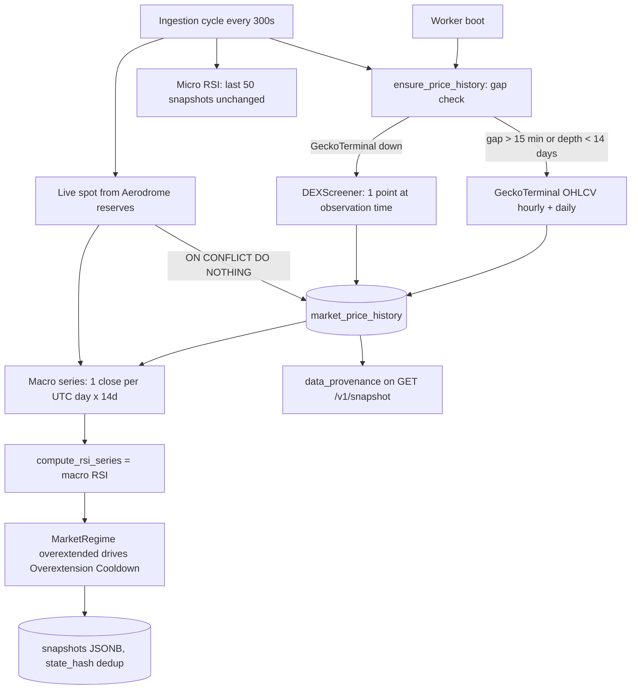

# Design: Historical Price Backfill & Multi-Timeframe Regime Engine

## Context

All changes are confined to `nocknock/ingestion-worker/` (backend-only; the frontend does not consume regime fields, and the Brain stays pure math). The worker already has: a `reqwest` client (`Cargo.toml`, features `json` + `rustls`), sqlx migrations run at boot (`main.rs` L463), an ingestion loop (`run_ingestion_cycle`, L1136) on a `sync_window_seconds` (300s) interval, a fail-open HTTP retry precedent (`post_rpc_with_retry`, L1335), and a pure Wilder RSI helper (`compute_rsi_series`, L1658) with unit tests. The regime path currently reads `LIMIT 50` snapshots (~70 minutes of closes).

Provider shapes verified live (2026-10-12):
- GeckoTerminal `GET https://api.geckoterminal.com/api/v2/networks/base/pools/{pool}/ohlcv/{day|hour}?limit=N` → `data.attributes.ohlcv_list: [[open_time_unix_secs, open, high, low, close, volume], ...]`, **newest-first**, USD prices (base NOCK / quote USDC). Unauthenticated, ~30 req/min limit.
- DEXScreener `GET https://api.dexscreener.com/latest/dex/pairs/base/{pool}` → `pairs[0].priceUsd` (string) — current price only.
- Pool: `0x85f1aa3a70fedd1c52705c15baed143e675cd626` (already in `config.yaml.example` `tracked_pools`).

## Architecture



## Phase A — Database Schema

New migration `ingestion-worker/migrations/20261012000004_create_market_price_history.up.sql` (naming follows existing `YYYYMMDDNNNNNN_description.up.sql`; repo ships up-migrations only):

```sql
CREATE TABLE IF NOT EXISTS market_price_history (
    timestamp      TIMESTAMPTZ NOT NULL PRIMARY KEY,
    price_usd      FLOAT8 NOT NULL,
    open_usd       FLOAT8,
    high_usd       FLOAT8,
    low_usd        FLOAT8,
    close_usd      FLOAT8,
    volume_usd     FLOAT8,
    source         VARCHAR NOT NULL,
    is_backfilled  BOOLEAN NOT NULL DEFAULT false,
    backfilled_at  TIMESTAMPTZ
);
CREATE INDEX IF NOT EXISTS idx_market_price_history_ts_desc
    ON market_price_history (timestamp DESC);
```

Semantics:
- **Contemporaneous rows** (every cycle with a valid live spot): `timestamp = cycle time`, `price_usd = spot`, OHLCV columns `NULL` (a spot observation is not a candle), `source='aerodrome_rpc'`, `is_backfilled=false`. Inserted **before** the `state_hash` dedup short-circuit in `run_ingestion_cycle`, so a deduped snapshot still records its real observed price.
- **Backfilled rows**: `timestamp = candle open time (UTC)`, `price_usd = candle close`, OHLCV filled, `source='geckoterminal'`, `is_backfilled=true`, `backfilled_at = insert time`.
- Plain table (no TimescaleDB hypertable) — the row volume (~300 rows/day) is trivial and `init-db.sql` keeps Timescale optional.

## Phase B — Gap Detection & Backfill Worker

Keep the logic testable by splitting pure decisions from I/O (the file's established pattern):

1. **Pure planner** `plan_backfill(last_point: Option<DateTime<Utc>>, earliest_point: Option<DateTime<Utc>>, now: DateTime<Utc>) -> BackfillPlan` where `BackfillPlan { backfill_hours_since_last: bool, backfill_daily_depth: bool, seed_fallback_point: bool }`:
   - gap: `now - last_point > 15 min` (or table empty) → hourly backfill + fallback seeding;
   - depth: `earliest_point > now - 14 days` (or `None`) → daily backfill (`limit=30` covers 30 days).
2. **GeckoTerminal client**: `GET .../ohlcv/hour?limit=168` and `.../ohlcv/day?limit=30`; serde structs for `data.attributes.ohlcv_list`; entries are newest-first → reverse to ascending. Skip any candle whose open time is ≥ the latest contemporaneous point (do not rewrite recent history).
3. **Idempotent upsert**: `INSERT ... ON CONFLICT (timestamp) DO NOTHING` — first writer wins; reruns are no-ops; a backfilled candle can never overwrite an existing contemporaneous row. No `DO UPDATE`: re-fetching identical third-party data has no reason to rewrite anything.
4. **Fallback**: only when GeckoTerminal fails AND a gap exists → one DEXScreener point at `timestamp = now` (observation time, never backdated), `source='dexscreener'`, `is_backfilled=true`. Log `degraded: true`-style warning per the mock-data invariant.
5. **Lifecycle & fail-open**: `ensure_price_history(&state)` runs once at boot (before the first ingestion cycle, after migrations) and at the start of every `run_ingestion_cycle` (so mid-run sleep gaps heal before macro RSI is computed). All provider/DB errors inside it are caught, logged (`tracing::warn!`), and swallowed — it can never abort the cycle. No cron scheduler needed; the 5-minute cycle is the tick.
6. **Rate-limit courtesy**: 2-3 HTTP calls max per check (daily + hourly + optional fallback), honoring the ~30 req/min public limit; on HTTP 429 log and stop.

## Phase C — Macro Indicator Refactor

- **Macro series**: one close per UTC day from `market_price_history` (daily candle `close_usd` when present, else last `price_usd` of that day via `DISTINCT ON (date_trunc('day', timestamp)) ... ORDER BY day, timestamp DESC`), ascending; append the live spot as the current partial day's close; feed `compute_rsi_series(&closes, 14)` (existing pure helper, unchanged). Need ≥ 15 closes for a value, else `None`.
- **Micro series**: unchanged — last 50 snapshots' reserve-derived closes + live spot (`rsi_14`, preserved semantics).
- **`MarketRegime`** (L1690) gains `rsi_macro: Option<f64>`; `overextended` is keyed on `rsi_macro >= RSI_OVERBOUGHT (70.0)` instead of the micro value. `compute_derived_metrics` Overextension branch (L2936-2945) cites the macro value in its directive text ("Macro RSI(14) {r:.0} >= 70").
- **`GlobalStatus`** (serialized at L3008-3012): keep `rsi_14` (micro, unchanged semantics for existing consumers), add `rsi_macro_14: Option<String>` (`"{:.1}"` formatting, matching `rsi_14`); `regime: "normal"|"overextended"` now reflects the macro call. Directive text already carries the explicit value, so MCP consumers stay coherent.

## Provenance Exposure on `/v1/snapshot`

`get_latest_snapshot_handler` (L650-714) currently returns `Json(json!(envelope))`. Change: serialize the envelope to a `serde_json::Value` and inject a top-level `data_provenance` object computed live from the table:

```json
"data_provenance": { "last_backfill_at": "<rfc3339|null>", "backfilled_points_count": 123 }
```

Deliberately **not** added to `SnapshotEnvelope`/`SnapshotData`: `state_hash` is `sha256(canonical(SnapshotData))` and `store_snapshot` dedups on it — a per-cycle provenance count would destabilize the hash and break ETag/304 caching for every consumer. The 304 path is untouched (provenance only rides on 200 responses).

## Configuration

Optional `market_data` section in `config.yaml.example` + serde-defaulted struct in `AppConfig` (missing section = defaults, matching how `notifications` degrades):

```yaml
# market_data:
#   geckoterminal_base_url: "https://api.geckoterminal.com/api/v2"
#   dexscreener_base_url: "https://api.dexscreener.com/latest"
#   pool_address: "0x85f1aa3a70fedd1c52705c15baed143e675cd626"
#   gap_threshold_minutes: 15
#   min_history_days: 14
#   hourly_lookback: 168
#   daily_lookback: 30
#   backfill_enabled: true
```

Pool address defaults to the tracked Aerodrome pool (already present in config); `config::Environment` gives `APP_MARKET_DATA__...` overrides for free.

## Key Decisions & Rationale

1. **Separate `market_price_history` table** rather than stuffing candles into the `snapshots` JSONB: snapshots are immutable observation records deduped by `state_hash`; price candles need upserts, gap queries, provenance columns, and a different retention profile.
2. **`ON CONFLICT DO NOTHING`** for idempotency (AC3) — simpler and safer than `DO UPDATE`: nothing is ever rewritten, and provenance of whichever row landed first is preserved.
3. **Top-level `data_provenance` on the API response**, not inside the envelope — keeps `state_hash` dedup/ETag stable (see above).
4. **Additive timeframe-named RSI field** rather than repurposing `rsi_14` — per reviewer, terminology follows industry standard: RSI(14) means a 14-period lookback (bars of the underlying timeframe), NOT 14 days. The macro indicator is therefore the **daily RSI(14)**, exposed as `rsi_14_1d`; the existing `rsi_14` keeps its 5-minute-series semantics. Rust-side `MarketRegime` uses `rsi_5m`/`rsi_1d`.
5. **In-cycle gap check** instead of a separate cron job — the sleep-gap scenario occurs mid-run, so the check must run per cycle; boot runs once more to cover restarts on a stale DB.
6. **No new dependencies** — `reqwest`, `chrono`, `sqlx`, `serde_json` already in `Cargo.toml`.

## Testing Strategy

Pattern-consistent with the existing `#[cfg(test)]` module in `main.rs` (pure-math tests; `make test-worker` runs without a live DB):
- `parse_geckoterminal_ohlcv`: fixture JSON (verified live shape above, newest-first) → ascending candles with correct fields; malformed entries skipped.
- `parse_dexscreener_price`: `priceUsd` string → f64; missing field → error.
- `plan_backfill`: empty table → full backfill; fresh table + no gap + sufficient depth → no-op; stale last point → hourly; shallow history → daily.
- Macro day-bucketing: interleaved contemporaneous + candle points → exactly one close per UTC day, last-wins per day.
- RSI order/gap invariance: macro RSI of a series assembled from backfilled + contemporaneous rows equals RSI of the same values sorted by timestamp (RSI is computed over closes, not timestamps).
- Overextension regression (the core bug): micro series overbought + macro series normal → `overextended=false`, no "Overextension Cooldown"; macro overbought → directive fires citing macro RSI.
- DB-gated integration tests (graceful skip when `DATABASE_URL` is unset, mirroring the frontend contract-test pattern): idempotent re-upsert of the same candle → 1 row; backfill cannot overwrite a contemporaneous row at the same timestamp.

## Learnings for Implementers (codebase notes)

- **sqlx offline**: `.sqlx/` cache (5 query files) is git-tracked. New `query!`/`query_scalar!` macros require regenerating the cache against a live Postgres (`cargo sqlx prepare`) or using runtime `sqlx::query(...)` + `try_get` (the regime/cycle code mostly uses the runtime form — prefer it for new queries to keep `SQLX_OFFLINE=true cargo build` green without DB access).
- **Migrations**: up-migrations only, idempotent (`IF NOT EXISTS`), executed by `sqlx::migrate!` at boot.
- **Fail-open precedent**: follow `post_rpc_with_retry` / notification dispatch — log, never propagate to the cycle result.
- **state_hash caution**: `compute_state_hash` hashes only `SnapshotData`; anything per-cycle must stay out of it (dedup depends on it).
- **Frontend**: no changes needed; `frontend/src/api/freshness.contract.test.ts` validates the snapshot schema additively, so a new response field is safe.
- **Release**: bump `ingestion-worker/Cargo.toml` to `0.3.0`, add a `CHANGELOG.md` section; tag only after merge + green CI (branch protection protocol in `AGENTS.md`).

## Implementation Notes (learned while building it)

- **Reviewer terminology correction adopted**: RSI(14) is a 14-period lookback, so fields are named by timeframe (`rsi_14_1d` daily / `rsi_14` 5-minute), and the directive text says "daily RSI(14)". The original request's "macro RSI spanning 14 days" is realized as daily RSI(14) over a ≥14-day close series.
- **sqlx dual-mode gotcha**: setting `DATABASE_URL` makes sqlx 0.7 compile-time check even RUNTIME `sqlx::query()` calls against the live DB (not just `query!` macros). With an empty/partial schema the pre-existing `snapshots` macros fail — apply all four migrations before running tests with `DATABASE_URL` set; without the var, `SQLX_OFFLINE=true` builds skip all of it (runtime queries need no `.sqlx` entries).
- **Migration ordering for tests**: sandbox Postgres only had `market_price_history` (applied by hand) until the other three migrations were applied via psql; then the full suite + integration tests ran green. The worker's own `sqlx::migrate!` at boot re-runs cleanly (all DDL is `IF NOT EXISTS`; the snapshot-id `ALTER TYPE UUID` is a no-op on an already-UUID column).
- **Parallel test race**: two `#[tokio::test]`s racing `CREATE TABLE IF NOT EXISTS market_price_history` hit Postgres's pg_type duplicate-key race — fixed with a single retry in the test helper. If you add more DB tests, reuse `ensure_market_price_history_table`.
- **In-progress candle rule matters**: GeckoTerminal returns the current (partial) candle newest-first. Skipping candles less than one period old (`now - open < candle_period`) is what prevents freezing a partial close into history forever (DO NOTHING would never refresh it). Live run backfilled 161 of 168 hourly candles — the missing 7 are the excluded current/recent partials and provider-side gaps.
- **Gap semantics**: `last_point = MAX(timestamp)` includes contemporaneous spot rows, so a healthy 5-min cadence keeps hourly backfill silent even though the newest *hourly candle* is up to ~1h old. Only genuinely missing wall-clock time triggers fetches.
- **E2E numbers (2026-10-12, live GeckoTerminal + live Alchemy via config.yaml)**: boot on empty table → 29 daily + 161 hourly candles; second check no-op; cycle 280-434ms; DB split 190 geckoterminal/backfilled vs contemporaneous aerodrome_rpc; `rsi_14_1d = 38.3` from 30 real daily closes; `regime: normal`; provenance stable across cycles.
- **Pre-existing lint debt**: `make validate-specs` fails on `origin/main` (3 errors: api.yaml `ClaimFeesPayload`/`ClaimFeeAction` schemas live directly under `components:` instead of `components/schemas:`, missing `info.license`; 13 example-validation warnings). Feature added zero new problems — do not treat the red `make validate-specs` as a regression from this branch.
- **Toolchain gotcha**: this sandbox's non-interactive shell has no cargo on PATH — use `/home/retro/.cargo/bin/cargo` or export PATH; `frontend/node_modules` needs `npm install` before `make test-frontend` (vitest).
- **v0.4.0 standing order (reviewer, pre-merge)**: Koinly work is Issue #56 (on-chain DeFi transaction classifier reconciling with Koinly's direct Base wallet sync, tagging fee claims as ordinary income). Do NOT build manual CSV download buttons or extra CSV tooling — Koinly's direct wallet sync plus a manual CSV produces duplicate transactions and burns the annual 1,000-tx budget ($99 tier). v0.3.0 stays scoped to backfill + macro RSI split + frontend observability.
- **Frontend envelope types live in three places** (`types/snapshot.ts`, `hooks/useFreshness.tsx`, `api/client.ts` — the hook/client mirror meta locally); a new envelope field must be added to all three or App.tsx can't see it through the hook's typing. App.tsx reads `snapshot?.data as any`, so data fields are loose, but the hook's envelope is strict.
- **Provenance refresh caveat**: `useFreshness` only swaps the stored envelope when `state_hash` changes; since provenance is deliberately excluded from the hash, a provenance-only change displays on the next accepted snapshot — acceptable for slowly-changing telemetry (and it keeps dedup stable).
